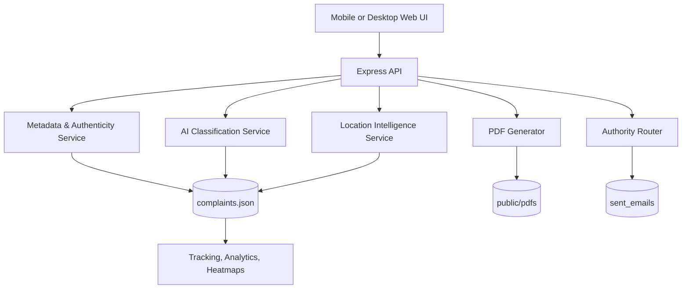

# Road Safety Complaint Portal

Production-ready road defect complaint platform for citizens and road authorities. The system combines image authenticity checks, AI-based defect classification, location intelligence, smart routing, dashboards, PWA support, and a modular backend designed for future expansion.

## Product Scope

The platform currently supports:

1. Complaint submission with photo upload, mobile camera capture, and GPS sharing.
2. EXIF-based authenticity verification and duplicate detection.
3. AI model integration for pavement condition classification.
4. Road context resolution and authority routing.
5. Complaint tracking, PDF generation, and email logging.
6. Geospatial heatmaps and analytics dashboards.
7. PWA support for home-screen installation and offline shell caching.

## Architecture



## Core Modules

- `server.js`: API routes, complaint workflow, location endpoints, stats, and export hooks.
- `services/metadataService.js`: EXIF parsing, image freshness checks, duplicate checks, visual similarity flags, and authenticity scoring.
- `services/modelService.js`: Local `.pt` model bridge and deployed API integration.
- `services/locationService.js`: Reverse geocoding, road type classification, and authority selection.
- `services/emailService.js`: PIU/authority routing, email preview logging, and dispatch metadata.
- `services/pdfService.js`: Complaint letter generation.
- `public/js/app.js`: Mobile upload flow, location capture, road context population, AI suggestions, dashboards, and heatmaps.

## Complaint Data Model

Each complaint stores a rich record for auditing, routing, and analytics:

```json
{
  "id": "NHAI-2026-XXXXXXX",
  "imageMetadata": {},
  "authenticityScore": 0,
  "verificationFlags": [],
  "roadName": "",
  "roadType": "",
  "authority": "",
  "district": "",
  "state": "",
  "landmark": "",
  "severity": "",
  "estimatedDimensions": "",
  "trafficImpact": "",
  "safetyRisk": "",
  "routingStatus": ""
}
```

Additional stored fields include:

- `modelResults`
- `aiEnrichment`
- `roadContext`
- `piuEmailMapping`
- `metadataResults`
- `status`
- `createdAt`

## API Reference

### Complaint Workflow

- `POST /api/complaints`
- `GET /api/complaints`
- `GET /api/complaints/:id`
- `GET /api/complaints/stats`
- `GET /api/complaints/geo`

### Intelligence & Location

- `POST /api/model/analyze`
- `GET /api/location/context?lat=&lon=`
- `GET /api/location/options`

### Activity Logs

- `GET /api/email-activity`

## Configuration

Environment variables supported by the platform:

```bash
HOST=0.0.0.0
PORT=3000
NODE_ENV=development
CORS_ORIGIN=*

USE_LOCAL_PT_MODEL=true
MODEL_WEIGHTS_PATH=./best.pt
MODEL_PYTHON_PATH=python
USE_REAL_MODEL_API=false
MODEL_API_ENDPOINT=http://localhost:8000/predict
MODEL_API_TIMEOUT_MS=10000

PHOTO_FRESHNESS_HOURS=48
LOCATION_MISMATCH_KM=2

ENABLE_REVERSE_GEOCODING=true
REVERSE_GEOCODE_ENDPOINT=https://nominatim.openstreetmap.org/reverse
REVERSE_GEOCODE_TIMEOUT_MS=4000
```

## Future Expansion Areas

This codebase is structured so these can be added without a rewrite:

1. Multi-language translation packs for all UI labels and messages.
2. Role-based access control for citizens, reviewers, and administrators.
3. Complaint escalation workflows and SLA timers.
4. GIS layers from government road datasets.
5. External data connectors for road inventory and asset condition.
6. SMS and WhatsApp notifications.
7. Automated duplicate clustering and similarity search at scale.
8. Audit trails and immutable event logs.
9. Chat-based grievance assistant.
10. Export pipelines for CSV, PDF, and BI tools.
11. Additional analytics pages for severity trends and locality hotspots.
12. OpenAPI / Swagger documentation.
13. Public API keys integration for data.gov.in, NHAI, and MoRTH-backed datasets where available.

## Testing Notes

Recommended manual checks:

1. Upload a real geotagged mobile image and confirm GPS, road context, and authority fields populate.
2. Upload a screenshot or edited image and confirm authenticity flags are raised.
3. Test mobile camera upload, gallery upload, and GPS sharing on a phone.
4. Confirm the heatmap dashboard reflects stored complaints.
5. Verify the complaint record contains the new road and metadata fields.

## Repository Structure

```text
server.js
services/
public/
data/
sent_emails/
best.pt
```

## Notes for Contributors

- Keep API responses backward-compatible where possible.
- Prefer modular service changes over adding logic directly to route handlers.
- Use relative frontend API calls so the same build works behind localhost, LAN, and public hosts.
- Treat `data/complaints.json` as the local persistence layer unless a database is introduced later.
